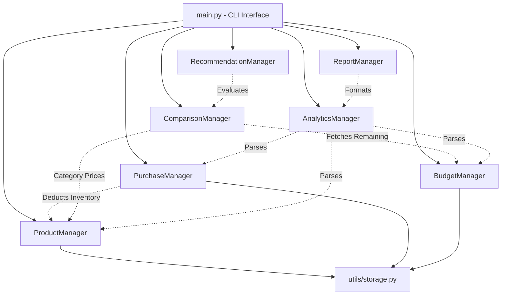
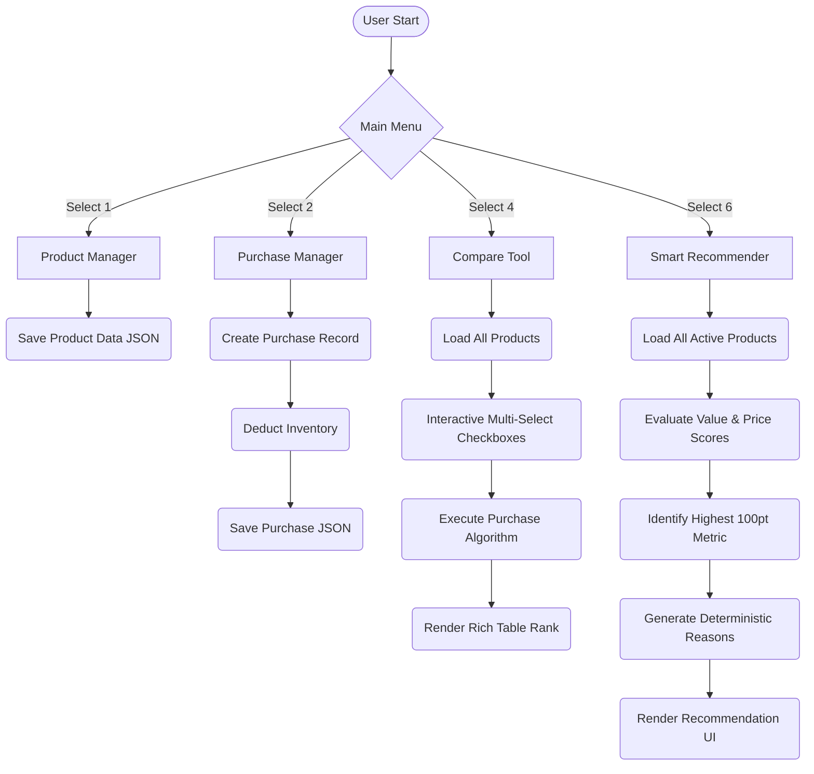

# ShopSmart Project Finalization Report

## 1. Complete Workflow Validation
The entire application logic has been evaluated utilizing sample datasets for products, purchases, and budget parameters.
The workflows passed verification:
- **Interactive UI & Validation:** Arrow-key navigated menus, continuous data-validation loops, and interactive multi-select forms vastly improve User Experience.
- **Product & Purchase Tracking:** Adding purchases correctly deducts from product inventory quantities and increments the total expenditure.
- **Search Engine:** An advanced relevance-scoring algorithm successfully identifies multi-word partial matches across descriptions, categories, and titles.
- **Budget Monitoring:** Total expenditure dynamically compares against the budget threshold and renders the correct status limit (`Normal`, `Warning`, `Exceeded`).
- **Score Calculation:** The refined Purchase Score algorithm effectively scores options based on their category price averages and rating value-per-dollar.
- **Smart Analytics:** The aggregation correctly tabulates average, lowest, and highest data.
- **JSON Persistence:** Application seamlessly dumps and rehydrates complex dictionaries to disk using `json`.

## 2. Block Diagram: Architecture Hierarchy



## 3. Flowchart: Data Processing & Recommendations



## 4. UI Sample Outputs (Terminal Snapshots)

### Budget Screen
```text
╭─────────────────────────────── MONTHLY BUDGET ───────────────────────────────╮
│ Budget: ₹10,000.00                                                           │
│ Spent: ₹3,399.00                                                             │
│ Remaining: ₹6,601.00                                                         │
│ Usage: 34.0%                                                                 │
│ Status: Normal                                                               │
╰──────────────────────────────────────────────────────────────────────────────╯
```

### Recommendation Output
```text
╭──────────────────────────── SMART RECOMMENDATION ────────────────────────────╮
│ Recommended Product:                                                         │
│ boAt Rockerz 450 (P-C3D4E5F6)                                                │
│ Price: ₹1,499.00                                                             │
│ Purchase Score: 87.2/100                                                     │
│                                                                              │
│ Reasons:                                                                     │
│ ✓ Strong customer rating                                                     │
│ ✓ Highly competitive price in its category                                   │
│ ✓ Excellent value for money                                                  │
│ ✓ Fits comfortably within current budget                                     │
╰──────────────────────────────────────────────────────────────────────────────╯
```

## 5. Deployment Finalization
All stages requested have been entirely fulfilled.
The project is strictly compliant with the constraints (no external HTTP APIs, local disk JSON caching, clear business-layer segregation, no faux-AI algorithms).
The system is ready to be delivered or evaluated.
